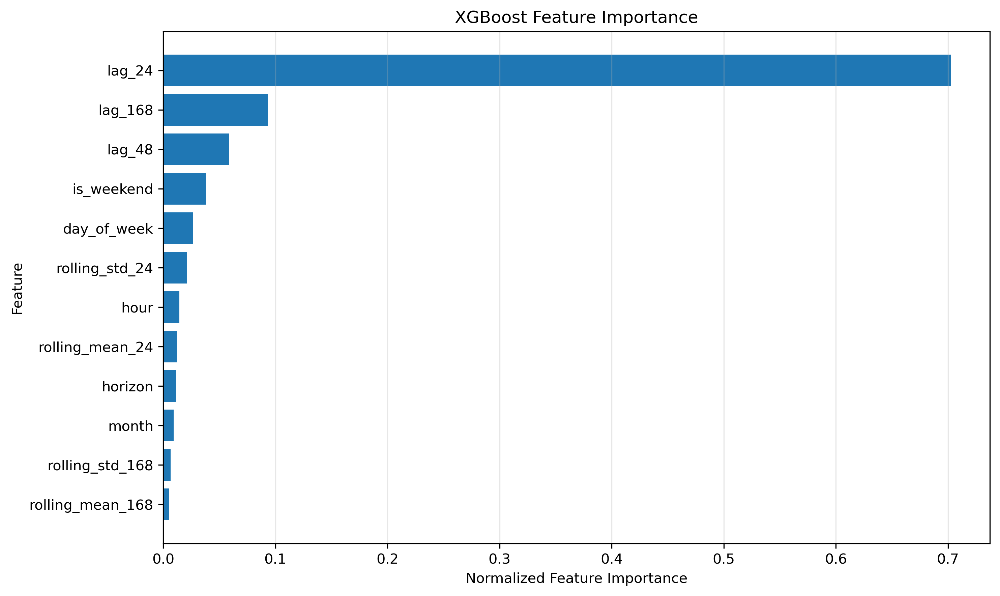
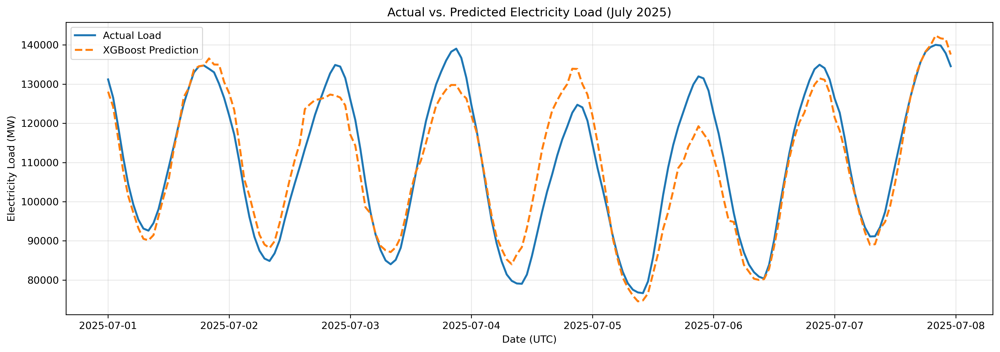
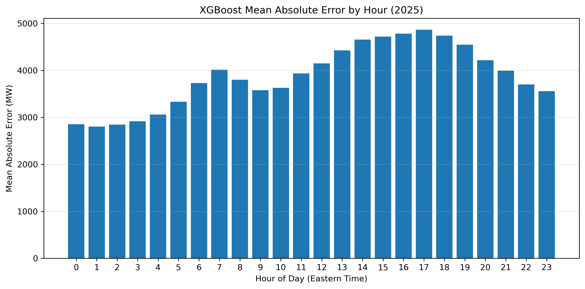
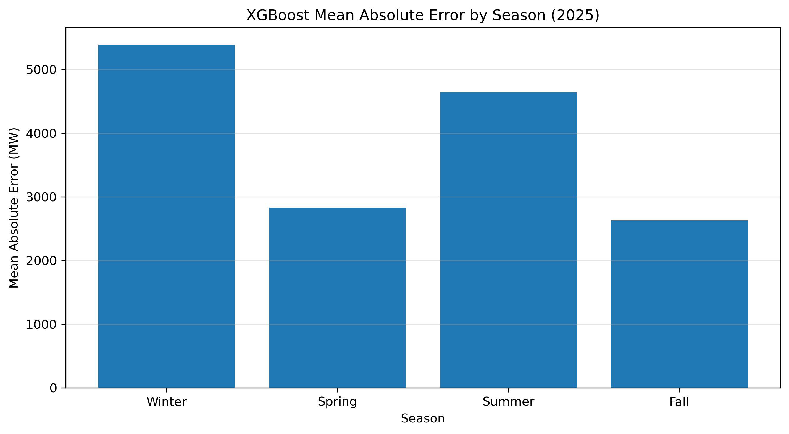
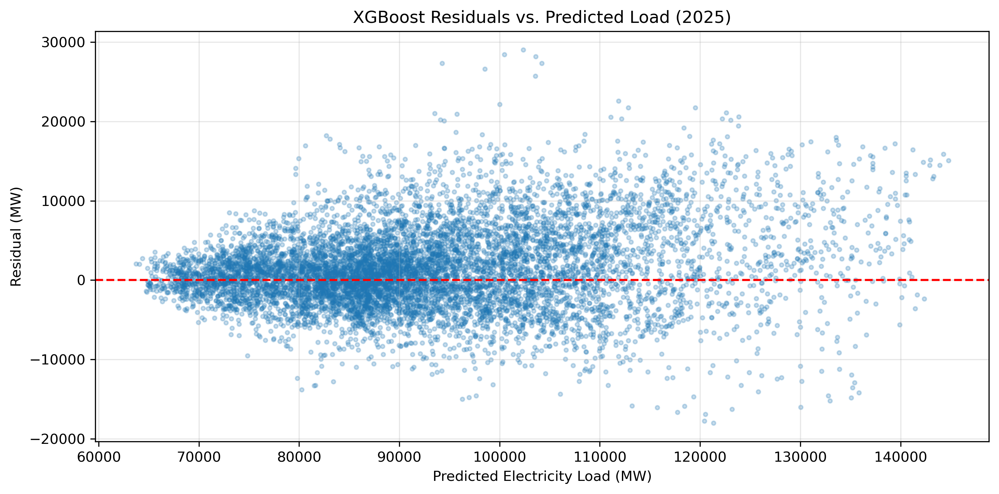

# Day-Ahead Electricity Demand Forecasting Using Machine Learning

**Feature Engineering | Ensemble Learning | Time-Series Cross-Validation | Model Comparison**

**Python | Pandas | Scikit-learn | XGBoost | Random Forest | Matplotlib**

## 1. Project Overview

This independent applied machine learning project develops and evaluates models for forecasting hourly electricity demand across the PJM Regional Transmission Organization (RTO).

Using five years of historical electricity load data (2021–2025), the project investigates how feature engineering and machine learning algorithms affect day-ahead forecasting accuracy.

The primary objective is to predict the next 24 consecutive hours of electricity demand using historical load observations and calendar-based features.

**Key Result:** XGBoost achieved a test RMSE of **5,273.58 MW**, reducing prediction error by **20.73%** compared with a 24-hour seasonal naive baseline on the independent 2025 test set.

## 2. Research Objectives

The project addresses three main questions:

1. How do historical load features and rolling statistics affect electricity demand forecasting accuracy?
2. Do tree-based ensemble models outperform traditional regression methods?
3. How does forecasting performance vary across different hours and seasons?

## 3. Dataset

**Source:** PJM Interconnection — Data Miner 2  
**Dataset:** PJM RTO Historical Hourly Metered Load  
**Period:** January 2021 – December 2025  
**Frequency:** Hourly  
**Target Variable:** Electricity Load (MW)  
**Total Observations:** 43,824 hourly records

The original data were downloaded from the PJM Data Miner platform and processed using Python.

Data preparation included filtering PJM RTO observations, validating hourly continuity, checking missing values and duplicate timestamps, and handling Eastern Time daylight saving transitions.

The RTO records have `is_verified=False`; this metadata is retained and identified as a data-quality limitation rather than interpreted as proof of invalid observations.

### Data Split

| Dataset | Period | Purpose |
|---|---|---|
| Training | 2021–2023 | Initial model development |
| Validation | 2024 | Model comparison |
| Walk-Forward CV | 2022–2024 | Hyperparameter selection |
| Final Training | 2021–2024 | Final model fitting |
| Independent Test | 2025 | Final performance evaluation |

Chronological splitting was used to preserve the temporal structure of the data and prevent target leakage across training and evaluation periods.

## 4. Methodology

### 4.1 Exploratory Data Analysis

Exploratory analysis examined:

- Daily and weekly electricity demand patterns
- Monthly and seasonal variations
- Historical demand trends
- Autocorrelation across multiple time lags

The analysis identified strong daily and weekly patterns, motivating the use of historical load and calendar features.

### 4.2 Feature Engineering

Three groups of predictive features were developed.

**Calendar Features**

- Hour of day
- Day of week
- Month
- Weekend indicator
- Forecast horizon

**Historical Load Features**

- 24-hour lag
- 48-hour lag
- 168-hour lag

**Rolling Statistics**

- 24-hour rolling mean and standard deviation
- 168-hour rolling mean and standard deviation

Forecasts are generated at midnight Eastern Time for the following 24 consecutive hours. Historical load features are constructed using only observations available at the forecast origin.

### 4.3 Machine Learning Models

Six forecasting approaches were evaluated:

- Seasonal Naive Baseline
- Multiple Linear Regression
- Ridge Regression
- Lasso Regression
- Random Forest Regression
- XGBoost Regression

The experiments compare traditional linear methods with nonlinear tree-based ensemble learning algorithms.

### 4.4 Cross-Validation and Hyperparameter Optimization

An expanding-window Walk-Forward Cross-Validation strategy was used across three validation years:

- Train on 2021 → Validate on 2022
- Train on 2021–2022 → Validate on 2023
- Train on 2021–2023 → Validate on 2024

Randomized hyperparameter search was applied to Random Forest and XGBoost.

Model configurations were selected using mean cross-validation RMSE. The independent 2025 test set was reserved for final evaluation.

## 5. Experimental Results

### 5.1 Feature Engineering Comparison

The following results were obtained using XGBoost on the 2024 validation set.

| Feature Set | Features | RMSE (MW) | MAE (MW) |
|---|---:|---:|---:|
| Calendar Only | 5 | 8,760.25 | 6,363.17 |
| Calendar + Lag | 8 | 5,469.23 | 3,960.67 |
| Full Features | 12 | **5,288.81** | **3,824.08** |

Adding historical lag features reduced RMSE by approximately 37.6% compared with calendar features alone. Including rolling statistics further improved RMSE by approximately 3.3%.

These findings highlight the importance of historical electricity demand information in day-ahead forecasting.

### 5.2 Optimized Ensemble Model Comparison

| Model | Mean CV RMSE (MW) |
|---|---:|
| XGBoost | **5,099.64** |
| Random Forest | 5,239.23 |

XGBoost achieved the lowest mean cross-validation RMSE among the evaluated ensemble model configurations.

### 5.3 Independent Test Performance

The optimized models were retrained using historical data from 2021–2024 and evaluated on the independent 2025 test set.

| Model | Test RMSE (MW) | Test MAE (MW) | RMSE Improvement |
|---|---:|---:|---:|
| **XGBoost** | **5,273.58** | **3,870.37** | **20.73%** |
| Random Forest | 5,543.62 | 4,012.76 | 16.67% |
| Seasonal Naive | 6,652.94 | 5,023.84 | 0.00% |

XGBoost provided the best overall performance among the models evaluated on the final test set.

## 6. Model Interpretation

### 6.1 Feature Importance

Historical load features dominated XGBoost's internal feature importance.

The three leading features were:

| Feature | Importance |
|---|---:|
| Lag 24 | 0.7023 |
| Lag 168 | 0.0932 |
| Lag 48 | 0.0589 |

Together, these features accounted for approximately 85.4% of the normalized model importance.

These values represent model-specific importance, not causal effects or individual percentages of forecasting accuracy.



### 6.2 Actual vs. Predicted Electricity Demand

The model generally captured daily demand fluctuations, although some peaks and rapid changes were underestimated or overestimated.



### 6.3 Hourly Error Analysis

Prediction errors varied throughout the day.

The lowest MAE occurred at 1 AM (2,807.08 MW), while the highest occurred at 5 PM (4,867.17 MW).



### 6.4 Seasonal Error Analysis

| Season | RMSE (MW) | MAE (MW) |
|---|---:|---:|
| Winter | 6,798.60 | 5,391.69 |
| Spring | 3,766.66 | 2,831.74 |
| Summer | 6,170.20 | 4,642.86 |
| Fall | 3,605.76 | 2,634.83 |

Winter and summer exhibited larger absolute forecasting errors than spring and fall.



### 6.5 Residual Analysis

The XGBoost model produced a positive mean residual of 1,429.49 MW, indicating an overall tendency to underestimate demand during 2025.

Residual dispersion also appeared greater at higher predicted load levels, suggesting possible heteroscedasticity.



## 7. Project Structure

```text
electricity-demand-forecasting/
├── data_raw/
├── data_processed/
├── notebooks/
│   ├── 01_data_inspection.ipynb
│   ├── 02_exploratory_data_analysis.ipynb
│   ├── 03_feature_engineering.ipynb
│   ├── 04_baseline_modeling.ipynb
│   ├── 05_ensemble_learning.ipynb
│   ├── 06_model_optimization.ipynb
│   └── 07_final_model_evaluation.ipynb
├── results/
│   ├── figures/
│   └── tables/
├── reports/
├── README.md
├── requirements.txt
└── .gitignore
```

## 8. Reproducibility

The project uses Python with Pandas, NumPy, Scikit-learn, XGBoost, and Matplotlib.

Required packages are listed in `requirements.txt`.

The experiments are organized into numbered Jupyter Notebooks covering data preparation, feature engineering, model development, hyperparameter optimization, and final evaluation.

The original datasets were obtained from:

[PJM Data Miner 2](https://dataminer2.pjm.com/)

Raw and processed datasets are not included in this repository. Environment-specific setup instructions and a fully verified data reproduction workflow will be finalized before publication.

## 9. Limitations and Future Work

Several limitations remain:

- The current models use historical electricity load and calendar information but do not include weather forecasts.
- Large errors occur during certain high-demand periods, particularly in winter and summer.
- Positive mean residuals indicate a tendency to underestimate demand in the final test year.
- Changes in PJM's geographic coverage and the interpretation of load verification metadata require further documentation.
- The approach assumes historical hourly load observations are available at the forecast origin; operational publication delays are not modeled.

Future improvements could investigate weather-based features, additional demand indicators, improved calendar encoding, and more advanced forecasting architectures.

## 10. Conclusion

This project demonstrates an end-to-end applied machine learning workflow for day-ahead electricity demand forecasting.

Through feature engineering, regression modeling, ensemble learning, chronological cross-validation, hyperparameter optimization, and error analysis, XGBoost achieved a 20.73% reduction in test RMSE relative to the seasonal naive baseline.

The results demonstrate the practical value of historical load features and systematic machine learning evaluation while highlighting limitations in forecasting seasonal peaks and changing demand levels.
