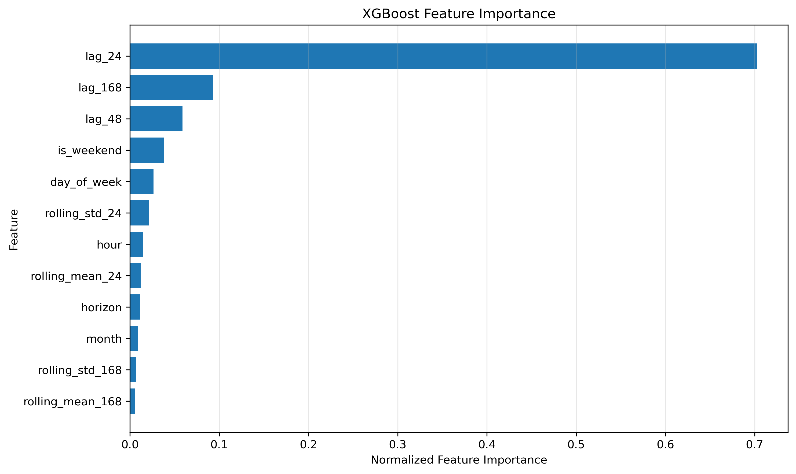
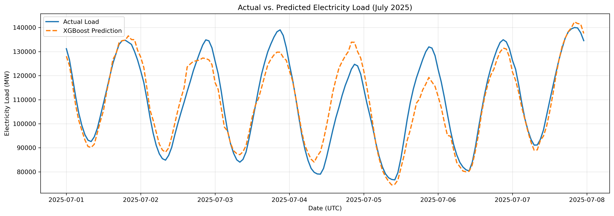
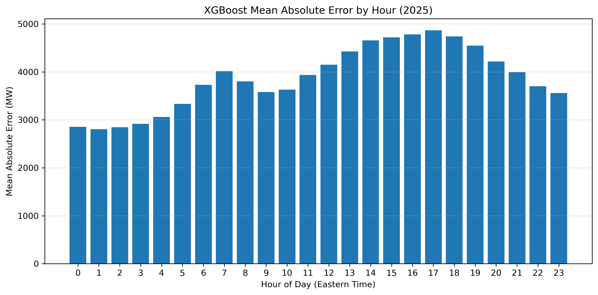
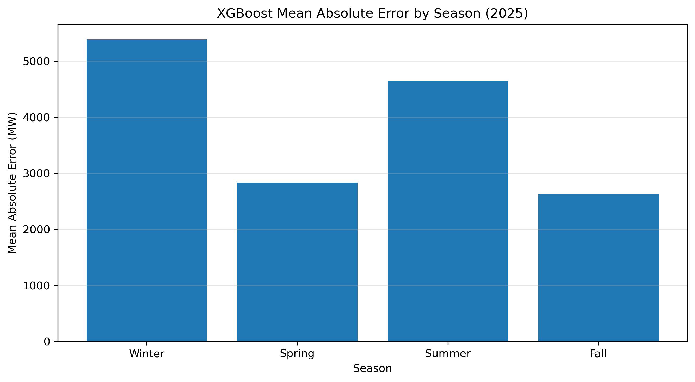
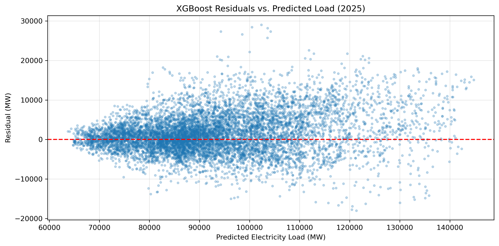

# Day-Ahead Electricity Demand Forecasting Using Machine Learning: Feature Engineering, Ensemble Learning, and Model Comparison

**Independent Applied Machine Learning Project**

---

## Abstract

This project investigates the effectiveness of machine learning methods for day-ahead electricity demand forecasting using hourly load data from the PJM Regional Transmission Organization (RTO) between 2021 and 2025. A supervised regression framework was developed to predict the next 24 consecutive hours of electricity demand using calendar variables, historical load lags, and rolling statistics. Multiple Linear Regression, Ridge, Lasso, Random Forest, and XGBoost were evaluated against a seasonal naive baseline. Feature ablation experiments, expanding-window cross-validation, and randomized hyperparameter search were used to assess forecasting performance and improve model selection.

On the independent 2025 test set, XGBoost achieved the lowest RMSE of **5,273.58 MW** and MAE of **3,870.37 MW**, representing a **20.73% reduction in RMSE** compared with the seasonal naive baseline. Historical load features were the most influential predictors, while error analysis revealed larger prediction errors during winter, summer, and afternoon peak-demand periods. These results demonstrate the value of feature engineering and tree-based ensemble learning for short-term electricity demand forecasting.

## 1. Introduction

Accurate electricity demand forecasting plays an important role in power system planning, resource scheduling, and grid operations. Electricity consumption varies across hours, days, and seasons, creating challenges for predicting future demand. These variations reflect recurring usage patterns as well as changing external conditions, making electricity forecasting a relevant application of machine learning.

Traditional regression models provide relatively simple and interpretable approaches to prediction but may struggle to capture nonlinear relationships and complex interactions among predictors. Tree-based ensemble methods, including Random Forest and Gradient Boosting, can model more flexible relationships without requiring explicit specification of nonlinear terms.

This project develops and evaluates machine learning models for forecasting hourly electricity demand across the PJM RTO. Using historical load observations from 2021 through 2025, the analysis focuses on feature engineering, model comparison, and out-of-sample predictive performance.

The study addresses three research questions:

1. **How does feature engineering affect forecasting accuracy?** Specifically, how much predictive value is gained from historical load lags and rolling statistics compared with calendar features alone?
2. **Do tree-based ensemble models outperform traditional regression methods?** The project compares linear regression approaches with Random Forest and XGBoost.
3. **How does forecasting performance vary across different periods?** The analysis examines prediction errors by hour and season and identifies limitations of the final model.

The project follows an end-to-end applied machine learning workflow involving data preprocessing, exploratory data analysis, feature engineering, supervised model training, chronological cross-validation, hyperparameter optimization, independent testing, and model interpretation.

## 2. Data and Preprocessing

### 2.1 Data Source

The dataset was obtained from PJM Interconnection's Data Miner 2 platform, using the Hourly Load: Metered dataset.

The data cover January 1, 2021, through December 31, 2025, and contain hourly electricity load observations expressed in megawatts (MW). The original files were downloaded separately for each calendar year and combined using Python.

The initial combined dataset contained approximately 1.31 million records covering multiple PJM load areas. This project focuses on the aggregate PJM RTO load series rather than individual geographic load areas.

After filtering the RTO observations, the resulting dataset contained **43,824 hourly observations** over five years, including 8,784 hours in leap year 2024.

### 2.2 Data Quality Assessment

Data inspection was conducted to ensure the integrity of the hourly time series.

The following checks were performed:

- Missing values across key variables
- Duplicate UTC timestamps
- Missing hourly observations
- Negative or zero electricity load values
- Annual load distributions and extreme observations

The filtered RTO dataset contained no missing values, no duplicate UTC timestamps, and no missing hourly intervals. All electricity load observations were positive.

The minimum recorded load was approximately 58,684.76 MW, while the maximum reached 160,154.43 MW on June 23, 2025.

The RTO observations were marked as unverified in the source metadata. This status was retained and documented as a data-quality limitation rather than treated as evidence that the measurements were invalid.

### 2.3 Temporal Processing

Both Coordinated Universal Time (UTC) and Eastern local time were retained during preprocessing.

UTC timestamps were used to maintain chronological ordering, uniquely identify observations, and verify hourly continuity. Eastern local time was used to construct calendar features such as hour of day, day of week, and month.

Daylight saving time transitions were explicitly considered. During 2021–2025, five local calendar days contained 23 hours and five contained 25 hours.

To maintain a consistent forecasting horizon, each forecast window was defined as 24 consecutive elapsed hours rather than requiring exactly 24 observations within every Eastern calendar day.

### 2.4 Exploratory Data Analysis

Exploratory analysis identified strong temporal patterns in electricity demand.

Daily demand generally reached its lowest levels overnight and peaked during late afternoon or early evening. Weekday electricity demand was higher than weekend demand, while monthly analysis revealed elevated load during summer and winter and lower average demand during spring and fall.

Autocorrelation analysis showed strong relationships between electricity load observations separated by 24 hours and 168 hours, with autocorrelation coefficients of 0.9106 and 0.7488, respectively.

These findings motivated the development of calendar features, daily and weekly lag features, and rolling historical statistics.

## 3. Methodology

### 3.1 Forecasting Framework

The project adopts a supervised regression framework for day-ahead hourly electricity demand forecasting.

At midnight Eastern Time, the forecasting system generates predictions for the next 24 consecutive elapsed hours.

Each forecast origin produces 24 target observations, with a forecast horizon ranging from 1 to 24. A pooled multi-horizon regression approach was used, allowing a single model to learn from examples associated with different prediction horizons.

The target variable is hourly electricity load measured in MW.

All historical load features were constructed from observations available before the forecast origin to prevent look-ahead bias.

The evaluation assumes that historical hourly load observations are available at the forecasting cutoff; operational data-publication delays were not modeled.

### 3.2 Feature Engineering

Three feature groups were developed.

**Calendar Features**

Five calendar-based features were included:

- Hour of day
- Day of week
- Month
- Weekend indicator
- Forecast horizon

These variables capture recurring temporal patterns and are known in advance of the target period.

**Historical Load Features**

Historical load information was represented using three lag variables:

- `lag_24`: electricity load 24 elapsed hours before the target
- `lag_48`: electricity load 48 elapsed hours before the target
- `lag_168`: electricity load 168 elapsed hours before the target

These lags capture daily and weekly demand relationships.

**Rolling Statistics**

Four rolling features summarized historical demand conditions:

- `rolling_mean_24`
- `rolling_std_24`
- `rolling_mean_168`
- `rolling_std_168`

Rolling statistics were calculated using the 24 or 168 hourly observations immediately preceding the forecast origin. Each target within the same forecasting window therefore received the same origin-level rolling statistics.

A total of **12 predictive features** were included in the full feature set.

### 3.3 Machine Learning Models

Six forecasting approaches were compared.

**Seasonal Naive Baseline**

The seasonal naive approach predicts each target using the observed load from 24 hours earlier:

\[
\hat{y}_t = y_{t-24}
\]

This provides a simple benchmark for measuring improvements from machine learning.

**Linear Regression**

Multiple linear regression was used as an initial supervised learning model to estimate electricity demand from the engineered predictors.

**Ridge and Lasso Regression**

Ridge and Lasso introduced L2 and L1 regularization, respectively, to control model complexity and examine whether coefficient shrinkage improved predictive performance.

Standardization was performed within training pipelines to ensure that regularization was applied consistently across variables with different numerical scales.

**Random Forest Regression**

Random Forest combined predictions from multiple randomized decision trees using bootstrap aggregation. This approach can capture nonlinear patterns and interactions without explicitly specifying them in a regression equation.

**XGBoost Regression**

XGBoost used gradient-boosted decision trees to iteratively improve predictions. The algorithm provided a flexible framework for modeling nonlinear relationships between calendar variables, historical electricity load, and future demand.

### 3.4 Training and Validation Strategy

The dataset was divided chronologically to preserve temporal dependence.

| Dataset | Period | Purpose |
|---|---|---|
| Initial Training | 2021–2023 | Model fitting |
| Validation | 2024 | Initial model comparison |
| Final Training | 2021–2024 | Final model fitting |
| Independent Test | 2025 | Final performance evaluation |

An expanding-window walk-forward validation procedure was applied using three chronological validation years:

| Fold | Training Period | Validation Period |
|---|---|---|
| 1 | 2021 | 2022 |
| 2 | 2021–2022 | 2023 |
| 3 | 2021–2023 | 2024 |

Training targets overlapping subsequent validation periods were excluded to reduce temporal leakage.

This procedure allowed model performance to be assessed across multiple years rather than relying exclusively on one validation period.

### 3.5 Hyperparameter Optimization

Randomized hyperparameter search was used to optimize Random Forest and XGBoost.

For Random Forest, the search examined the number of trees, maximum tree depth, minimum samples per leaf, and fraction of features considered at each split.

For XGBoost, the search examined the number of boosting iterations, maximum tree depth, learning rate, and minimum child weight.

Candidate configurations were evaluated using mean walk-forward validation RMSE.

The selected XGBoost configuration used:

| Hyperparameter | Selected Value |
|---|---:|
| Number of estimators | 300 |
| Maximum depth | 4 |
| Learning rate | 0.05 |
| Minimum child weight | 1 |
| Subsample | 0.8 |
| Column subsample | 0.8 |

Final hyperparameters were selected using development data without referring to the 2025 test results.

### 3.6 Evaluation Metrics

Prediction performance was evaluated using Root Mean Squared Error (RMSE) and Mean Absolute Error (MAE).

\[
RMSE=\sqrt{\frac{1}{n}\sum_{i=1}^{n}(y_i-\hat y_i)^2}
\]

\[
MAE=\frac{1}{n}\sum_{i=1}^{n}|y_i-\hat y_i|
\]

RMSE places greater emphasis on large prediction errors, while MAE measures the average absolute difference between predicted and observed electricity load.

Lower values indicate better predictive accuracy.

## 4. Experimental Results

### 4.1 Initial Model Comparison

Five machine learning models and the seasonal naive baseline were evaluated on the 2024 validation set.

| Model | Validation RMSE (MW) | Validation MAE (MW) |
|---|---:|---:|
| Seasonal Naive | 6,422.94 | 4,799.88 |
| Linear Regression | 5,660.35 | 4,295.51 |
| Ridge Regression | 5,660.19 | 4,295.42 |
| Lasso Regression | 5,658.35 | 4,293.93 |
| Random Forest | 5,410.38 | 3,931.35 |
| **XGBoost** | **5,288.81** | **3,824.08** |

All machine learning models outperformed the seasonal naive baseline.

The three linear regression approaches produced nearly identical results, indicating limited improvement from the initial regularization settings.

Random Forest and XGBoost achieved lower prediction errors than the linear models, suggesting that nonlinear tree-based ensembles were better suited to the current feature representation.

### 4.2 Feature Engineering Experiments

To evaluate the contribution of feature engineering, three feature sets were compared using the same initial XGBoost configuration.

| Feature Set | Number of Features | RMSE (MW) | MAE (MW) |
|---|---:|---:|---:|
| Calendar Only | 5 | 8,760.25 | 6,363.17 |
| Calendar + Lag | 8 | 5,469.23 | 3,960.67 |
| Full Features | 12 | **5,288.81** | **3,824.08** |

Adding historical lag features reduced validation RMSE by approximately **37.6%** compared with using calendar features alone.

Adding rolling statistics produced a further **3.3% reduction in RMSE**.

Overall, the full feature set achieved approximately **39.6% lower RMSE** than the calendar-only feature set.

These results indicate that historical load features contributed substantially more predictive information than calendar variables alone.

### 4.3 Walk-Forward Cross-Validation

The initial XGBoost model was evaluated across three chronological validation periods.

| Validation Year | RMSE (MW) | MAE (MW) |
|---|---:|---:|
| 2022 | 5,971.89 | 4,182.25 |
| 2023 | 4,347.74 | 3,199.83 |
| 2024 | 5,288.81 | 3,824.08 |
| **Mean** | **5,202.81** | **3,735.39** |

Prediction performance varied across years, with the lowest RMSE observed in 2023.

Although the training sample expanded over time, prediction error did not consistently decrease. This suggests that forecasting difficulty depends on differences between years as well as training sample size.

### 4.4 Hyperparameter Optimization Results

Randomized search identified improved model configurations.

| Model | Best Mean CV RMSE (MW) |
|---|---:|
| **XGBoost** | **5,099.64** |
| Random Forest | 5,239.23 |

XGBoost achieved the lowest mean cross-validation RMSE among the evaluated configurations.

Relative to its original mean CV RMSE of 5,202.81 MW, the tuned XGBoost configuration reduced the mean validation error by approximately **1.98%**.

The selected XGBoost model used fewer estimators and shallower trees than its initial configuration, indicating that increased model complexity did not necessarily improve generalization.

Because the same cross-validation folds were used for hyperparameter selection, the optimized cross-validation results should not be interpreted as unbiased estimates of future performance.

### 4.5 Independent Test Evaluation

After selecting the model configurations, Random Forest and XGBoost were retrained using historical data from 2021 through 2024.

Final evaluation was conducted on the independent 2025 test set.

| Model | Test RMSE (MW) | Test MAE (MW) | RMSE Improvement |
|---|---:|---:|---:|
| Seasonal Naive | 6,652.94 | 5,023.84 | 0.00% |
| Random Forest | 5,543.62 | 4,012.76 | 16.67% |
| **XGBoost** | **5,273.58** | **3,870.37** | **20.73%** |

XGBoost achieved the lowest prediction error among the evaluated models.

Compared with the seasonal naive benchmark, XGBoost reduced RMSE by **20.73%**.

This improvement demonstrates that the selected ensemble model provided additional predictive value beyond repeating observed demand from 24 hours earlier.

## 5. Model Interpretation and Error Analysis

### 5.1 Feature Importance

XGBoost feature importance was examined to identify which predictive variables were most influential within the trained model.

The three leading features were:

| Feature | Normalized Importance |
|---|---:|
| `lag_24` | 0.7023 |
| `lag_168` | 0.0932 |
| `lag_48` | 0.0589 |

Together, these historical load features accounted for approximately 85.4% of the model's normalized internal feature importance.

This finding is consistent with the feature ablation experiments, where adding lag features substantially improved predictive accuracy.

However, model-specific importance values do not represent causal effects or independent percentages of forecasting accuracy.

*Figure 1. XGBoost feature importance for the final model.*

### 5.2 Actual vs. Predicted Demand

A selected week in July 2025 was used to visualize the relationship between observed electricity load and XGBoost predictions.

The model generally captured recurring daily demand fluctuations, including periods of rising and falling consumption.

However, some peak loads were underestimated, while other periods showed overprediction. These discrepancies indicate limitations in predicting rapid changes and unusually high electricity demand.

*Figure 2. Actual and predicted hourly electricity demand during a selected week in July 2025.*

### 5.3 Hourly Error Analysis

Hourly MAE was calculated across the complete 2025 test period.

The smallest error occurred at 1 AM Eastern Time, while the largest occurred at 5 PM.

| Hour | MAE (MW) |
|---|---:|
| 1 AM | 2,807.08 |
| 7 AM | 4,016.15 |
| 12 PM | 4,149.17 |
| 5 PM | 4,867.17 |
| 11 PM | 3,560.04 |

Prediction errors generally increased during the afternoon and early evening.

This pattern suggests that the model has greater difficulty predicting electricity demand during higher-load periods in terms of absolute error.

*Figure 3. Mean absolute forecasting error by hour of day.*

### 5.4 Seasonal Error Analysis

Forecasting performance was also evaluated across four meteorological seasons.

| Season | RMSE (MW) | MAE (MW) |
|---|---:|---:|
| Winter | 6,798.60 | 5,391.69 |
| Spring | 3,766.66 | 2,831.74 |
| Summer | 6,170.20 | 4,642.86 |
| Fall | 3,605.76 | 2,634.83 |

Winter had the largest prediction errors, followed by summer.

Spring and fall generally exhibited smaller absolute errors.

These differences may reflect greater demand variability during periods of heating and cooling demand, although the present study does not include weather data sufficient to establish this explanation.

*Figure 4. Mean absolute forecasting error by season.*

### 5.5 Residual Analysis

Residuals were calculated as the difference between actual and predicted electricity load:

\[
e_i=y_i-\hat y_i
\]

The final XGBoost model produced a mean residual of **+1,429.49 MW** on the 2025 test set.

This positive value indicates an overall tendency to underestimate actual electricity demand.

The residual distribution also became more dispersed at higher predicted load levels, suggesting possible heteroscedasticity and increased forecasting uncertainty during high-demand periods.

The largest positive residual was approximately 29,012 MW, while the largest negative residual was approximately −17,999 MW.

These findings suggest that the model captures recurring patterns reasonably well but is less reliable during certain unusually large demand fluctuations.

*Figure 5. XGBoost residuals versus predicted electricity load.*

## 6. Discussion

The experimental results provide several insights into the application of machine learning to electricity demand forecasting.

First, historical load information played a central role in predictive performance. The substantial reduction in RMSE after introducing lag features demonstrates the value of recent and weekly demand observations. The strong importance of `lag_24` further supports the role of daily temporal dependence.

Second, nonlinear ensemble models outperformed traditional linear approaches in the initial validation experiments. Random Forest and XGBoost likely benefited from their ability to model nonlinear relationships and interactions among historical load and calendar variables without manually specifying complex regression terms.

Third, systematic model evaluation was important for assessing generalization. Walk-forward validation revealed meaningful performance differences across years, while randomized hyperparameter search provided moderate improvements over the original XGBoost configuration.

Finally, error analysis revealed limitations that aggregate RMSE and MAE values alone would not capture. The final model showed a tendency toward underprediction during 2025, with larger absolute errors during winter, summer, and afternoon peak-load periods.

These findings indicate that although historical electricity demand provides substantial predictive information, additional variables may be necessary to better capture changing demand conditions and extreme load fluctuations.

## 7. Limitations and Future Work

Several limitations should be considered when interpreting the results.

**Lack of Weather Features**

The models use historical electricity load and calendar information but do not incorporate temperature, humidity, or weather forecasts. Because weather conditions can influence electricity consumption, especially during extreme heating and cooling periods, including weather-related predictors may improve forecasting accuracy.

**Distribution Shift**

The final test year exhibited higher average electricity demand than earlier years. The positive mean residual suggests that the model may not fully capture changes in demand levels between the training and test periods. However, the observed residual bias alone does not establish the cause of the distribution shift.

**Extreme-Demand Forecasting**

The model produced relatively large errors for some high-demand observations. Further work could investigate approaches specifically designed to improve forecasting during peak-demand events.

**Forecast Information Availability**

The current evaluation assumes that historical load values are available immediately before each forecast origin. Real-world forecasting systems may face data reporting and publication delays, which would require additional adjustments to feature availability.

**Temporal and Geographic Generalizability**

The experiments focus on PJM RTO aggregate electricity demand over a specific historical period. Results may differ for other electricity markets, regions, or future periods.

Potential extensions include adding weather forecasts, incorporating holiday indicators, evaluating alternative calendar encodings, and exploring neural network approaches such as LSTM-based or other sequence forecasting architectures.

## 8. Conclusion

This project developed and evaluated an end-to-end applied machine learning framework for day-ahead electricity demand forecasting using historical PJM RTO load data.

The experiments demonstrated that historical load features substantially improved predictive performance compared with calendar features alone. Tree-based ensemble methods achieved lower validation errors than traditional linear regression approaches, while walk-forward cross-validation and randomized hyperparameter optimization supported systematic model selection.

On the independent 2025 test set, XGBoost achieved an RMSE of **5,273.58 MW** and an MAE of **3,870.37 MW**, representing a **20.73% reduction in RMSE** relative to the seasonal naive baseline.

Feature importance and residual analyses further revealed the importance of historical demand observations and identified limitations related to peak-load prediction, seasonal variation, and systematic underestimation.

Overall, this study demonstrates how feature engineering, ensemble learning, chronological model validation, and error interpretation can be integrated into a practical electricity demand forecasting workflow.

## References

PJM Interconnection. *Data Miner 2 — Hourly Load: Metered.* https://dataminer2.pjm.com/

Pedregosa, F., et al. (2011). Scikit-learn: Machine Learning in Python. *Journal of Machine Learning Research, 12*, 2825–2830.

Chen, T., & Guestrin, C. (2016). XGBoost: A Scalable Tree Boosting System. *Proceedings of the 22nd ACM SIGKDD International Conference on Knowledge Discovery and Data Mining*, 785–794.

Breiman, L. (2001). Random Forests. *Machine Learning, 45*, 5–32.